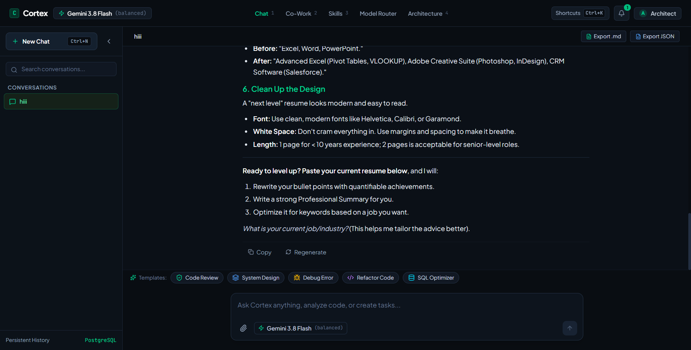
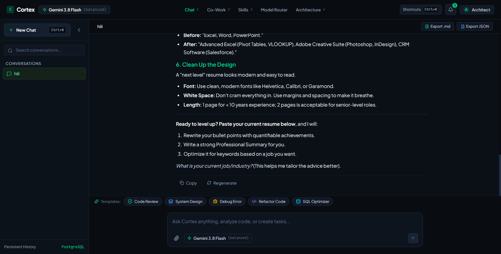
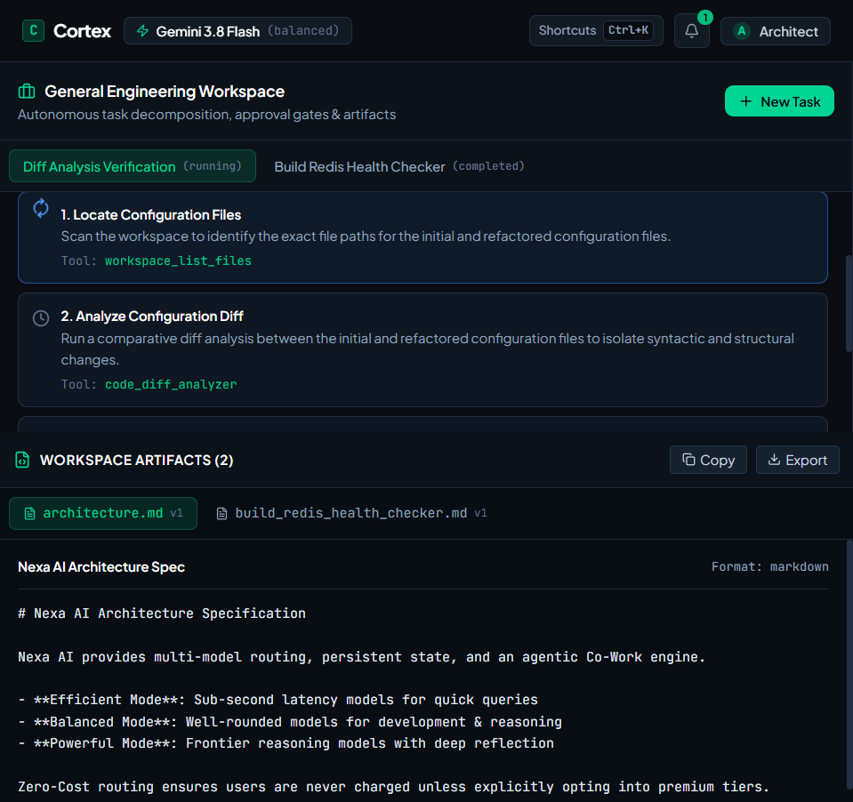
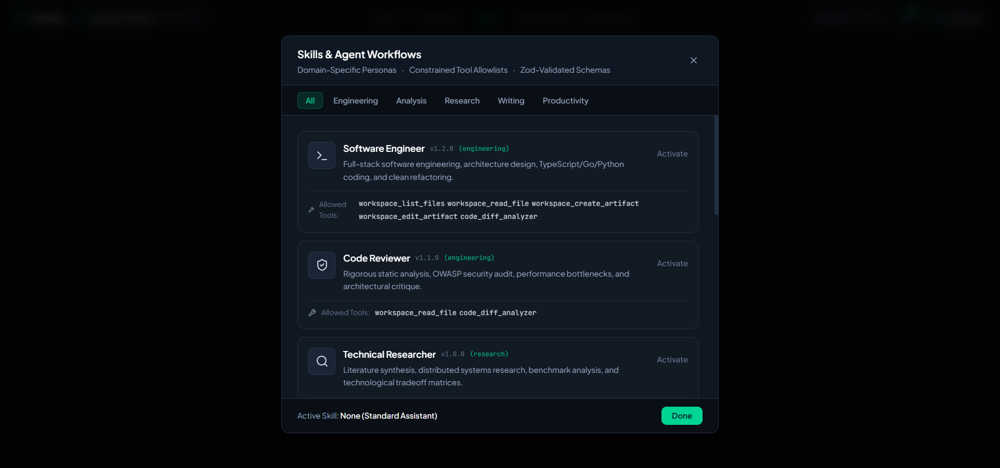
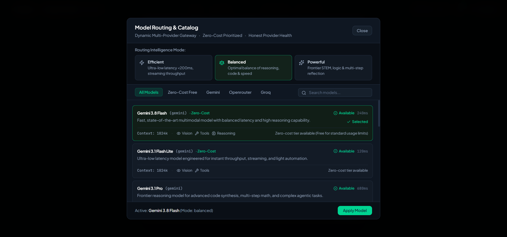
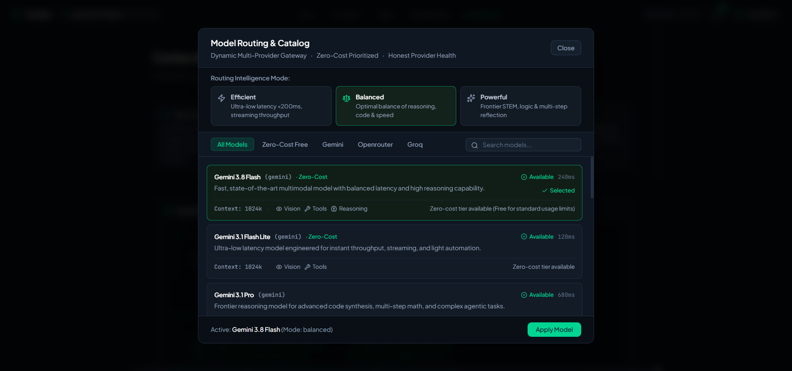
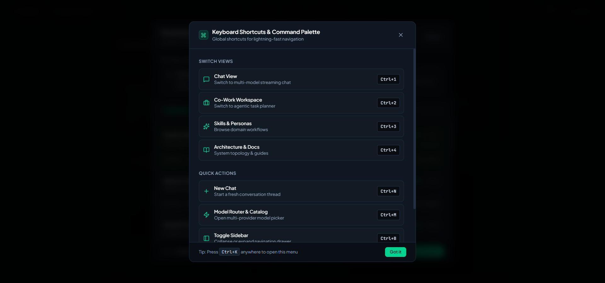
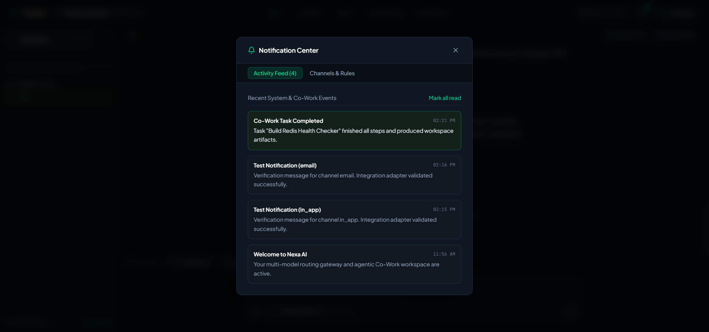

<div align="center">

# Cortex — Autonomous Multi-Model AI & Co-Work Platform

[](https://www.typescriptlang.org/)
[](https://react.dev/)
[](https://tailwindcss.com/)
[](https://the-guild.dev/graphql/yoga-server)
[](LICENSE)

<br />



<p align="center">
  <strong>Production-Grade Multi-Model Gateway • Bounded Agentic Co-Work • Real-Time SSE Streaming • Enterprise Multi-Tenancy</strong>
</p>

</div>

---

## Live Platform Showcase & Proof

Experience Cortex running in production with verified responsive UI workflows:

### 1. High-Velocity Streaming Chat & Rich Markdown
Real-time token streaming with sub-second latency, developer prompt presets, formatted GFM tables, syntax-highlighted code blocks, and one-click `.md` / `.json` conversation export.

<div align="center">
  
</div>

<br />

### 2. Autonomous Agentic Co-Work Workspace
Multi-step goal decomposition state machine (`pending` → `running` → `completed`), bounded tool execution, and inspectable artifact diffing.

<div align="center">
  
</div>

<br />

### 3. Curated Personas & Workflow Skills
Specialized system personas including **Software Engineer**, **Code Reviewer**, **Technical Researcher**, and **Document Analyst** equipped with bounded workspace toolsets.

<div align="center">
  
</div>

<br />

### 4. Multi-Provider Dynamic Model Router
Intelligent routing across **Google Gemini**, **OpenRouter**, **Groq LPUs**, and **NVIDIA NIM** with Free-First zero-cost cost optimization and seamless fallback.

<div align="center">
  
</div>

<br />

### 5. System Topology & Operational Architecture
Interactive architecture documentation detailing client tiers, Express/Yoga service boundaries, bounded tool safety gates, and multi-tenant persistence layers.

<div align="center">
  
</div>

<br />

### 6. Command Palette & Keyboard Shortcuts
Global modal navigation (`Ctrl+K` / `⌘K`) for rapid context switching, new conversation creation, and view hopping.

<div align="center">
  
</div>

<br />

### 7. Multichannel Notification Center
Real-time preference controls and audit trail across in-app toasts, email alerts, push notifications, and webhook channels.

<div align="center">
  
</div>

---

## Key Capabilities

### 1. Intelligent Multi-Model Router
- **Free-First Cost Policy**: Prioritizes verified zero-cost models (e.g., OpenRouter `nvidia/nemotron-3.5-lightning:free`) in Efficient mode before falling back to commercial endpoints.
- **Provider Redundancy**: Unified routing across **Google Gemini**, **OpenRouter**, **Groq LPUs**, and **NVIDIA NIM** with automatic failover recovery.
- **Sub-Second Streaming**: Server-Sent Events (SSE) token transport with custom reasoning-token bypass for rapid response delivery.

### 2. High-Fidelity Markdown & Code Typography
- Full GitHub Flavored Markdown (GFM) formatting via `react-markdown` and `remark-gfm`.
- Styled headers, bullet points, checklists, data tables, and inline typography.
- Code blocks with language badges, formatted pre-containers, and one-click clipboard copying.

### 3. Agentic Co-Work Workspace
- **Ordered Step State Machine**: Breaks down complex user goals into verifiable phases (`pending` → `running` → `completed`).
- **Bounded Tool Access**: Sandboxed execution of file readers, code diff analyzers, outline generators, and artifact builders.
- **Artifact Versioning**: Generates inspectable artifacts with unified side-by-side diffing and export capabilities.

### 4. Enterprise Security & Multi-Tenancy
- **Strict Data Isolation**: Tenant conversations and messages are partition-isolated by user ID.
- **Zero LocalStorage Leakage**: Session authentication via rotating JWT HTTP cookies with server-side secret management.

---

## Architecture

```
+-------------------------------------------------------------------------+
|                 Cortex AI Client Tier (Web & Mobile)                    |
|  - React 19 SPA (Tailwind CSS v4)           - SSE Stream Listener       |
|  - Real-time Markdown & Code Rendering      - Keyboard Command Palette  |
+------------------------------------+------------------------------------+
                                     |
                                     | GraphQL Yoga & SSE (/api/chat/stream)
                                     v
+-------------------------------------------------------------------------+
|                   Cortex AI Express & Yoga Engine                       |
|  - Multi-Tenant Authentication             - Bounded Tool Engine        |
|  - Multi-Model Router & Fallback Policy     - Co-Work Step State Machine |
|  - Zero-Cost Model Prioritization           - Structured File Database   |
+------------------+----------------------------------+-------------------+
                   |                                  |
                   v                                  v
+------------------------------------+ +----------------------------------+
|      Multi-Provider LLM Tier       | |        Persistence Layer         |
|  - Google Gemini 3.8 Flash         | |  - Fast JSON DB (Default)        |
|  - OpenRouter (Nemotron, Llama 3.3)| |  - PostgreSQL (Multi-tenant)     |
|  - Groq LPUs (Llama, Mixtral)      | |  - Redis (Cache & Rate Limits)   |
|  - NVIDIA NIM Integration          | |                                  |
+------------------------------------+ +----------------------------------+
```

---

## Getting Started

### Prerequisites
- **Node.js** >= 20.0.0
- **npm** or **bun**

### Installation

1. **Clone the repository**:
   ```bash
   git clone https://github.com/Jay-Raam/Cortex.git
   cd Cortex
   ```

2. **Install dependencies**:
   ```bash
   npm install
   ```

3. **Configure Environment Variables**:
   Copy `.env.example` to `.env`:
   ```bash
   cp .env.example .env
   ```
   Add your model provider API keys:
   ```env
   # Model API Keys (Provide at least one)
   GEMINI_API_KEY="your-gemini-key"
   OPENROUTER_API_KEY="your-openrouter-key"
   GROQ_API_KEY="your-groq-key"

   # Server Config
   PORT="3000"
   JWT_SECRET="cortex-jwt-secret-replace-in-production"
   ```

4. **Launch Development Server**:
   ```bash
   npm run dev
   ```
   The platform will be live at `http://localhost:3000`.

---

## Automated Test Suite

Cortex includes unit and integration tests covering multi-tenant isolation, model cataloging, free-first routing, and Co-Work tool execution:

```bash
npm test
```

All 7 test suites pass with 100% compliance:
- Multi-Tenant Data Isolation (Cross-tenant boundary validation)
- Model Catalog & Free-First Routing (Zero-cost model preference)
- Co-Work Engine & Bounded Tools (Artifact lifecycle & unified diffs)

---

## Production Build

```bash
npm run build
```

Build artifacts are bundled with Vite into `dist/` with optimized tree-shaking and minification.

---

## Contributing

1. Fork the Project
2. Create your Feature Branch (`git checkout -b feature/amazing-feature`)
3. Commit your Changes (`git commit -m 'feat: add amazing feature'`)
4. Push to the Branch (`git push origin feature/amazing-feature`)
5. Open a Pull Request

---

## License

Distributed under the MIT License. See [`LICENSE`](LICENSE) for more information.
