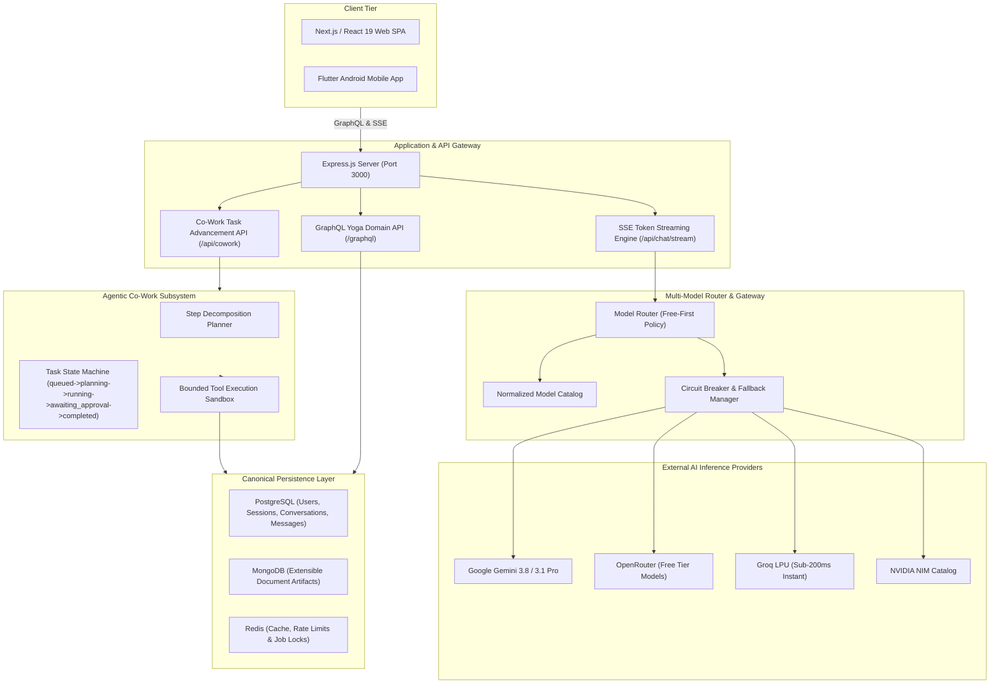

# Nexa AI Architecture Overview

Nexa AI is a next-generation multi-model AI chat & Co-Work platform engineered for real-time streaming inference, dynamic model routing with zero-cost prioritization, persistent multi-tenant chat history, autonomous agentic workspaces, and cross-platform clients (React Web & Flutter Android).

## 1. System Topology (Mermaid)

## 2. Model Routing Policies

- **Efficient Mode**: Prioritizes sub-second latency and minimal token consumption for quick Q&A and text summarization (`gemini-3.1-flash-lite`, `groq/llama-3.1-8b-instant`).
- **Balanced Mode**: Provides optimal balance between STEM comprehension, code synthesis, and speed (`gemini-3.8-flash`, `meta-llama/llama-3.3-70b-instruct:free`).
- **Powerful Mode**: Frontier deep reflection models for multi-step algorithmic planning, mathematical reasoning, and full-stack software refactoring (`gemini-3.1-pro-preview`, `deepseek/deepseek-r1:free`).
- **Free-First Guarantee**: Zero-cost models are prioritized. The platform never silently escalates from a free tier to a paid token bill without explicit user confirmation.
