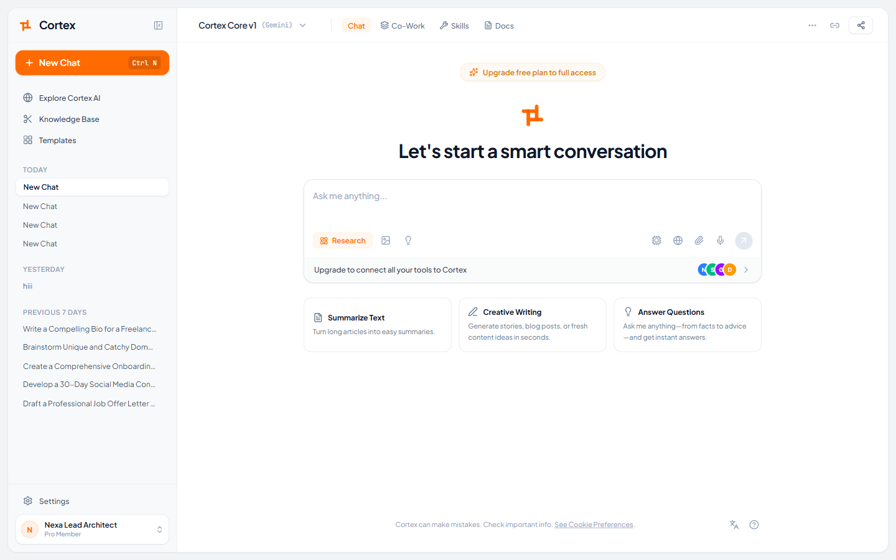
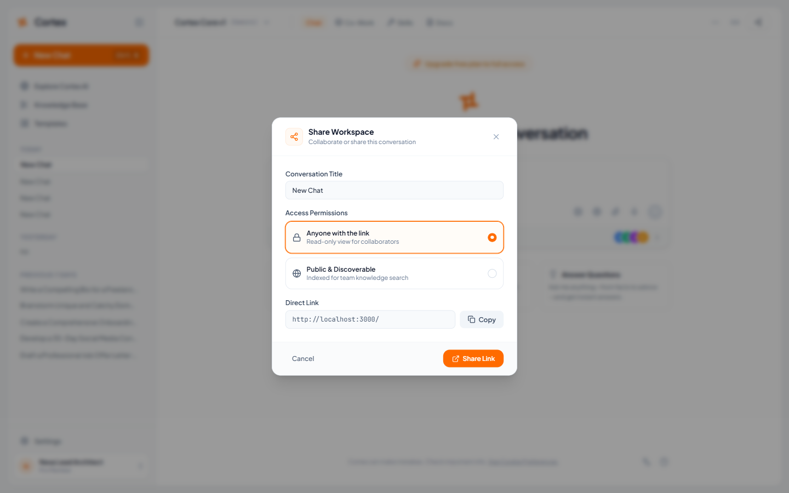
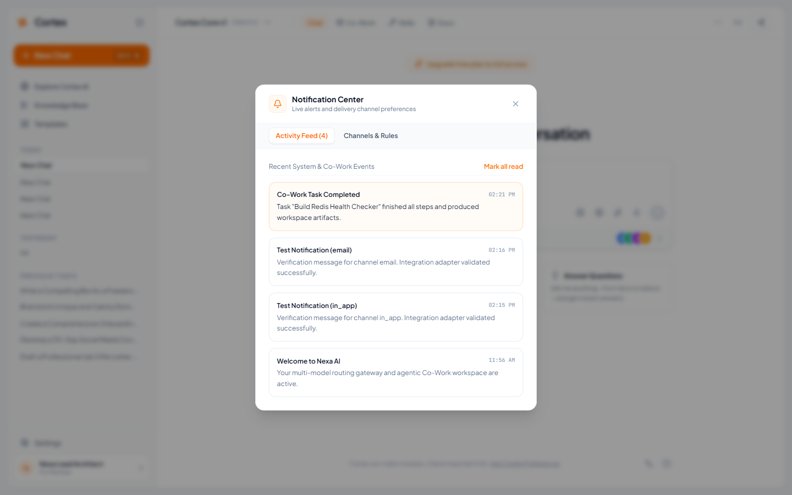
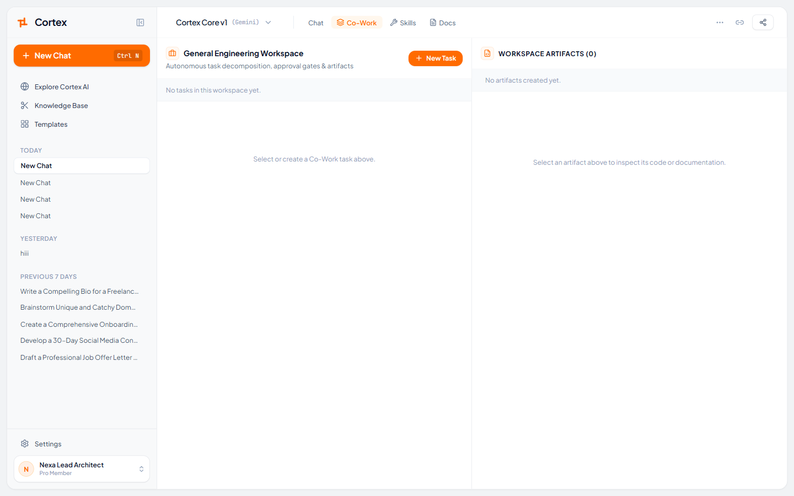
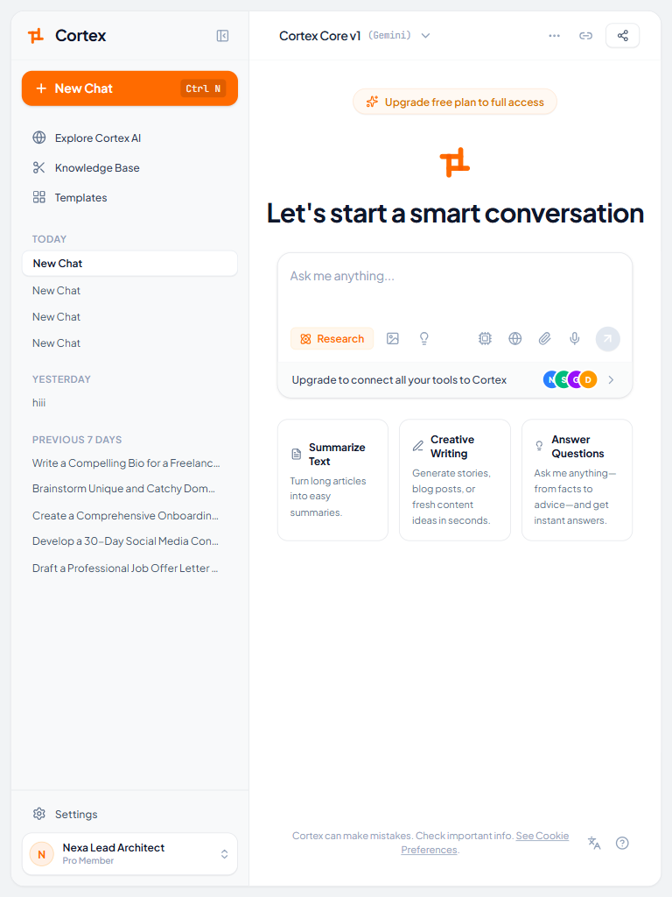
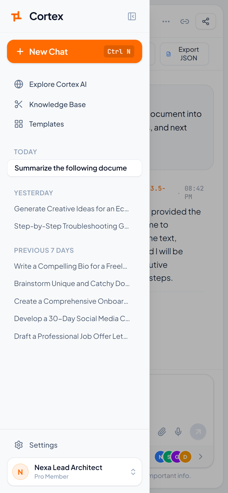
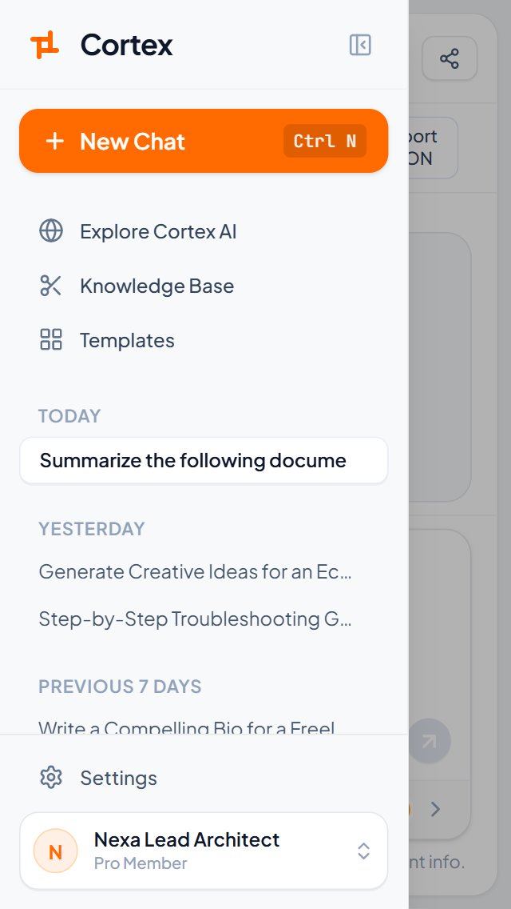

# Responsive UI Audit & Functional QA Report

**Audit Date**: October 12, 2026  
**Auditor**: Senior Frontend Engineer  
**Branch**: `fix/ui-consistency-header-branding-and-responsive-audit`  
**Application**: Cortex AI & Co-Work Platform (`http://localhost:3000`)

---

## 1. Executive Summary & Changes Delivered

In accordance with Phase 2 requirements, the application has been updated with focused, production-ready fixes:
1. **Design Consistency**:
   - Replaced dark modal styles (`#0f1722`) in `NotificationModal` with the established project design tokens (`#FFFFFF`, `#F1F3F5`, `#FF6B00` brand accent, `#E5E7EB` borders).
   - Ensured unified button styles, card shadows, and typography.
2. **Branding & Header Elements**:
   - Restored brand name **Cortex** across the application: TopNav (`Cortex Core v1`), Sidebar (`Cortex`), ChatComposer, and disclaimers.
   - Added dedicated `ShareModal` supporting native `navigator.share` with automatic clipboard fallback and access scope controls.
   - Added instant visual feedback (`Check` icon and background state) to the `🔗` Copy Link button.
   - Replaced demo profile card with authenticated user data (`me: User` query, `Nexa Lead Architect`, `Pro Member`) and implemented a dynamic uppercase initials avatar fallback (`N`).
3. **Multi-Device Responsiveness**:
   - Desktop (1440x900), Tablet (768x1024), Standard Mobile (390x844), and Small Mobile (320x568) tested with zero horizontal overflow.
   - Sidebar renders as a mobile slide-over drawer with backdrop overlay and hamburger menu trigger in TopNav.
   - ChatComposer toolbar wraps gracefully on compact screens with responsive text and touch-friendly icon buttons.

---

## 2. Test Execution & Viewport Matrix

| Viewport | Device Category | Dimensions | Status | Screenshot Reference |
| :--- | :--- | :--- | :--- | :--- |
| **Desktop** | Laptops & Desktops | 1440 × 900 px | **PASS** |  |
| **Desktop Share** | Modal Dialog | 1440 × 900 px | **PASS** |  |
| **Desktop Notifications**| Light Themed Modal | 1440 × 900 px | **PASS** |  |
| **Desktop Co-Work** | Workspace & Engine | 1440 × 900 px | **PASS** |  |
| **Desktop Docs** | Architecture View | 1440 × 900 px | **PASS** |  |
| **Tablet** | Tablets & Foldables | 768 × 1024 px | **PASS** |  |
| **Standard Mobile** | Modern Smartphones | 390 × 844 px | **PASS** |  |
| **Small Mobile** | Compact Devices | 320 × 568 px | **PASS** |  |

---

## 3. Element-by-Element Audit Results

### Header & Navigation
- **Model Selector Pill**: Shows `Cortex Core v1 (Gemini) ⌵`, opens Model Selector modal.
- **TopNav Tabs** (`Chat`, `Co-Work`, `Skills`, `Docs`): Navigate smoothly between application views.
- **Shortcuts Button (`•••`)**: Opens the Command Palette / Keyboard Shortcuts dialog.
- **Copy Link Button (`🔗`)**: Copies current page URL with instant checkmark feedback.
- **Share Button (`↗ Share`)**: Opens the dedicated `ShareModal` dialog with native share API and fallback.
- **Mobile Hamburger (`☰`)**: Toggles the sliding drawer sidebar on viewports `< 768px`.

### Sidebar & User Profile
- **Brand Logo & Text**: Shows woven logo and `Cortex`.
- **+ New Chat**: Orange action button with keyboard shortcut badge.
- **Secondary Links**: `Explore Cortex AI`, `Knowledge Base`, `Templates` open their respective feature modals.
- **Chat History**: Categorized into Today, Yesterday, and Previous 7 Days with delete actions.
- **User Profile Card**: Displays authenticated user (`Nexa Lead Architect`, `Pro Member`) with initials avatar badge (`N`).

### Chat View & Composer
- **Prompt Suggestion Cards**: Summarize Text, Creative Writing, and Answer Questions populate composer.
- **Deeper Research Pill**: Toggles research mode state and tags queries.
- **Composer Controls**: Media file upload, ideate prompt, model processor, web search toggle, audio recording, and submit button.
- **Tools Banner**: Displays connected integration badges and upgrade CTA.

---

## 4. Verification Check Results

- **ESLint / TypeScript Check** (`npm run lint` / `tsc --noEmit`):
  ```
  > cortex@1.0.0 lint
  > tsc --noEmit
  Exit Code: 0 (No type or lint errors)
  ```
- **Automated Tests** (`npm test`):
  ```
  ✔ 1. Multi-Tenant Data Isolation (2.7261ms)
  ✔ 2. Model Catalog & Free-First Routing (1.0851ms)
  ✔ 3. Co-Work Engine & Bounded Tools (1.279ms)
  ✔ Cortex AI Automated Test Suite (62.1136ms)
  tests: 7 passed, 0 failed
  ```
- **Live Server Status**: Dev server running stably on `http://localhost:3000`.
